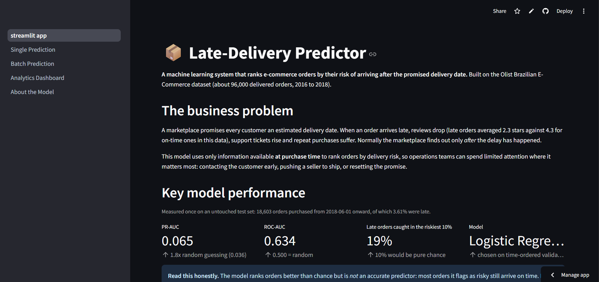
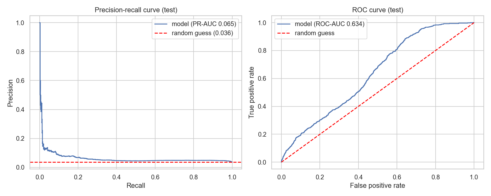
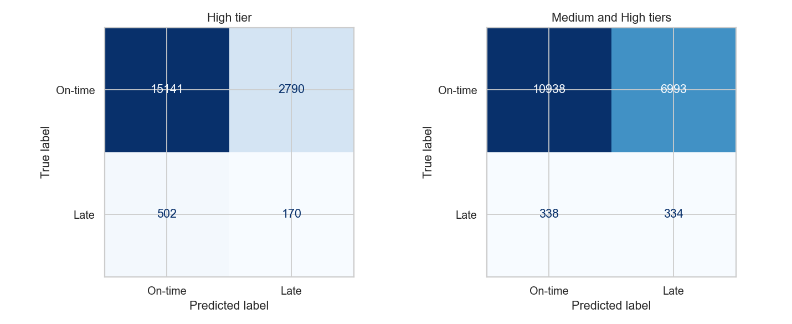
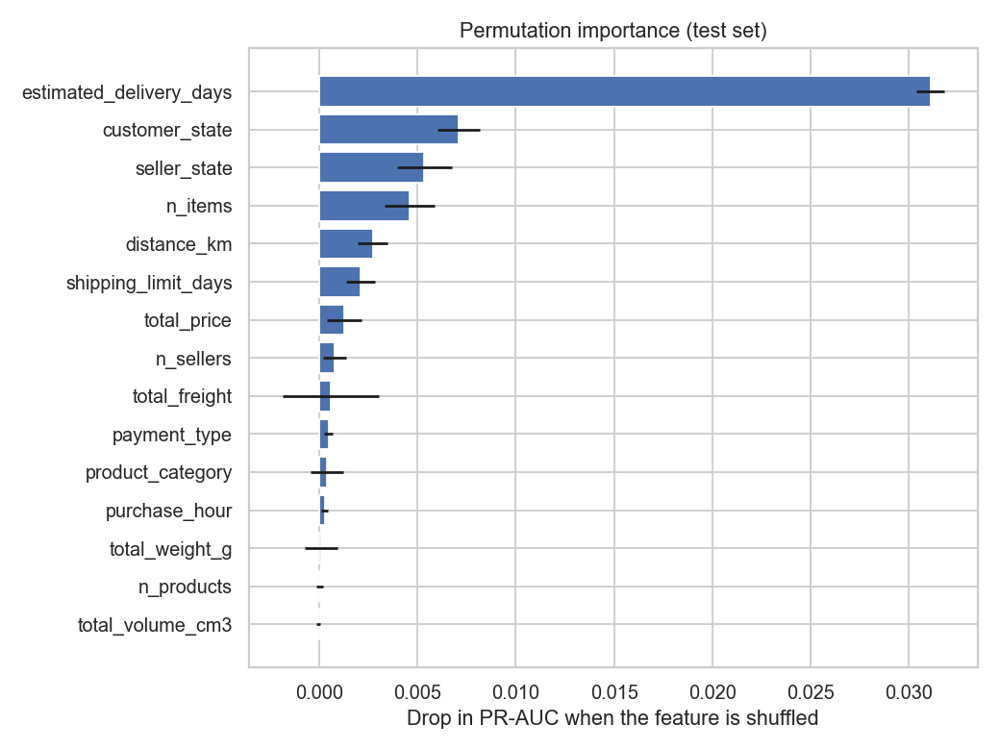
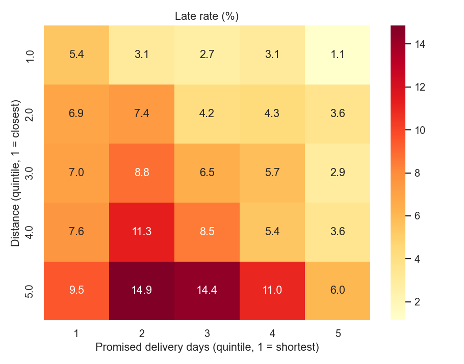
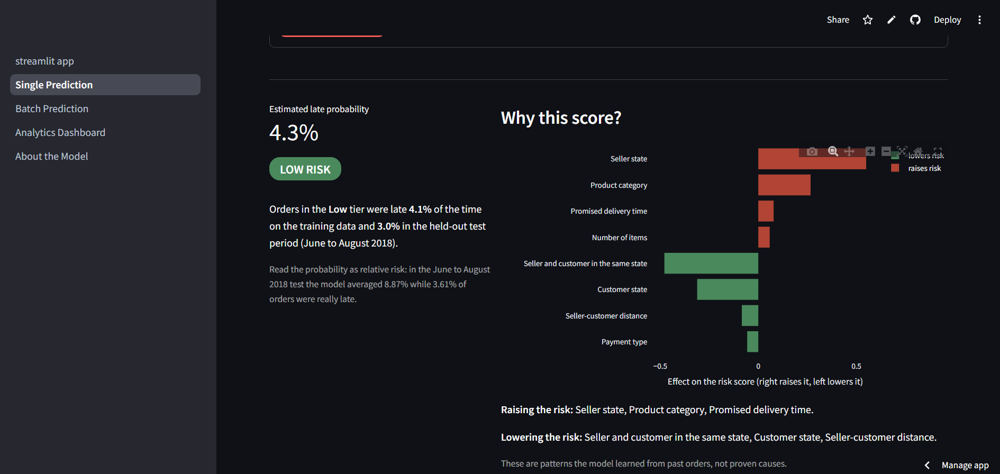
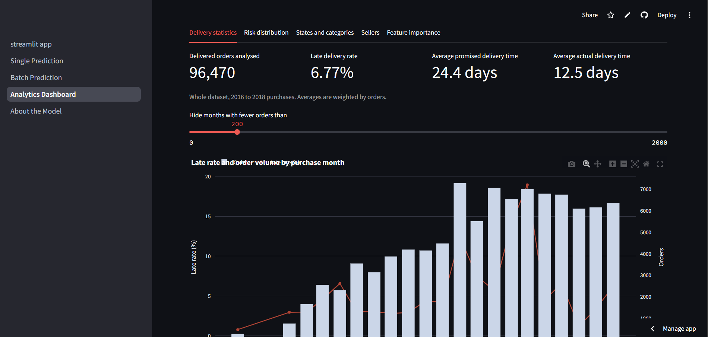
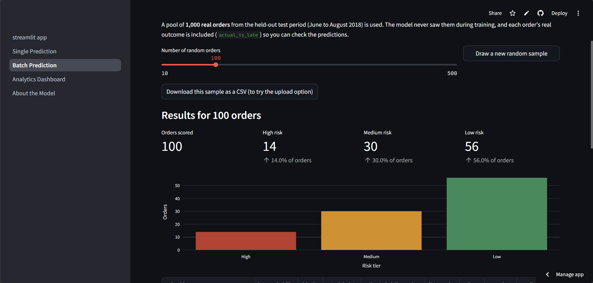

# 📦 Late-Delivery Predictor for an E-Commerce Marketplace

A machine learning system that ranks e-commerce orders by their **risk of arriving after the promised delivery date**, using only information available at purchase time. Built on the public [Olist Brazilian E-Commerce dataset](https://www.kaggle.com/datasets/olistbr/brazilian-ecommerce).

> 🔗 **Live app:** https://late-delivery-predictor-334o5suya67wwfxjtkgrlu.streamlit.app/
>
> No installation needed: open the link in any browser.



## Table of contents
1. [Business problem](#1-business-problem)
2. [Dataset](#2-dataset)
3. [Approach](#3-approach)
4. [Results](#4-results)
5. [Key insights from the data](#5-key-insights-from-the-data)
6. [The web app](#6-the-web-app)
7. [Limitations and future improvements](#7-limitations-and-future-improvements)
8. [Project structure](#8-project-structure)
9. [How to run](#9-how-to-run)
10. [Deployment](#10-deployment)
11. [Technologies](#11-technologies)

## 1. Business problem

A marketplace promises every customer an estimated delivery date. When an order arrives late, reviews drop (in this data, late orders average **2.3 stars against 4.3** for on-time ones), support tickets rise and repeat purchases suffer. Normally the marketplace learns about a delay only *after* it has happened.

- **Who has the problem:** operations and customer-service teams, sellers and customers.
- **Decision the model supports:** which orders deserve proactive attention right after purchase (contacting the customer early, pushing the seller to ship, choosing a faster carrier, resetting the promise). The model ranks orders by risk so limited attention goes where it matters most.
- **Target variable:** `is_late` = 1 if the order arrived on a calendar day **after** the estimated delivery date, otherwise 0.
- **Metrics that matter:** late orders are rare (about 7% of the data), so **accuracy is not used** (always predicting "on time" is already right about 93% of the time). The main metric is **PR-AUC**, supported by **recall in the riskiest 10% of orders** ("if we act on 10% of orders, how many late deliveries do we catch?"), precision (every false alarm costs operations time), F1 and ROC-AUC.

## 2. Dataset

- **Source:** [Brazilian E-Commerce Public Dataset by Olist (Kaggle)](https://www.kaggle.com/datasets/olistbr/brazilian-ecommerce). Nine CSV files: orders, items, customers, sellers, products, payments, reviews, geolocation and a category translation table.
- **Not included in this repository** because of its size. See [How to run](#9-how-to-run) for where to put it. Check the dataset page for its licence terms.
- **Modelling table:** one row per delivered order with a delivery date: **96,470 orders, 6.77% late**.
- **Split (by time, not at random):** the model must predict *future* orders.

| Set | Orders | Purchased | Late rate |
|---|---|---|---|
| Training | 75,429 | 2016-09-15 to 2018-05-29 | 7.12% |
| Untouched test | 18,603 | 2018-06-01 to 2018-08-29 | 3.61% |

2,438 orders bought before the cut-off but delivered after it were **purged** from training, because their label would not be known yet on the cut-off date.

## 3. Approach

1. **Data understanding:** sizes, types, missing values, join-key coverage and class balance for all nine tables.
2. **One row per order:** items, products, sellers, payments and geolocation are aggregated into a single table. Columns are split into allowed model inputs (known at purchase time) and analysis-only columns (delivery dates, order status, reviews), which are **never** model inputs.
3. **EDA:** univariate, bivariate and multivariate analysis, ending with written insights.
4. **Preprocessing inside a scikit-learn `ColumnTransformer` and `Pipeline`, fitted on training data only:** quantile clipping for outliers, median imputation, log transform and scaling for numbers, one-hot encoding for categories (rare and unseen categories handled).
5. **Modelling:** a Dummy baseline plus Logistic Regression, Random Forest and XGBoost, compared with **time-ordered cross-validation** on the training set.
6. **Tuning:** `GridSearchCV` and `RandomizedSearchCV` with the same time-ordered folds, training data only. Selection rule fixed in advance: PR-AUC within 0.01 of the best, then the highest recall in the riskiest 10%.
7. **Evaluation on the untouched test set:** confusion matrices, precision, recall, F1, ROC-AUC, PR-AUC, classification report, permutation feature importance and error analysis.
8. The final pipeline is saved with **Joblib** and loaded by the web app; nothing is retrained at runtime.

## 4. Results

**Selected model: Logistic Regression** (`C=0.03`, no class weights). All numbers below come from the notebook.

### Test set (June to August 2018, 18,603 orders, 672 late)

| Metric | Selected model | Dummy baseline (random guessing) |
|---|---|---|
| **PR-AUC** | **0.065** (1.8x the baseline) | 0.036 |
| **ROC-AUC** | **0.634** | 0.500 |



**What acting on the riskiest orders buys (test set):**

| Orders flagged | Precision | Recall (late orders caught) | Lift vs. chance | False alarms per late order caught |
|---|---|---|---|---|
| 5% | 8.2% | 11.3% | 2.26 | 11.2 |
| 10% | 6.9% | 19.0% | 1.91 | 13.5 |
| 20% | 5.3% | 29.3% | 1.47 | 17.9 |
| 30% | 4.7% | 39.4% | 1.31 | 20.1 |

**Risk tiers used by the app** (High = top 10% of scores on the training data, Medium = next 20%, Low = the rest):

| Tier | Test orders | Late orders | Late rate | Share of all late orders |
|---|---|---|---|---|
| High | 2,960 | 170 | 5.74% | 25.3% |
| Medium | 4,367 | 164 | 3.76% | 24.4% |
| Low | 11,276 | 338 | 3.0% | 50.3% |

At the High-tier cut-off the model flags 15.9% of orders with precision 5.7%, recall 25.3% and F1 0.094. Flagging both Medium and High flags 39.4% of orders with precision 4.6%, recall 49.7% and F1 0.084.



### Model comparison (cross-validation on the training set, mean of 3 time-ordered folds)

| Model | PR-AUC, default settings | PR-AUC, tuned (± std over folds) | ROC-AUC, tuned | Recall in riskiest 10%, tuned |
|---|---|---|---|---|
| Dummy (baseline) | 0.086 | n/a | 0.500 | 0.105 |
| Logistic Regression | 0.157 | 0.167 ± 0.038 | 0.666 | 0.244 |
| XGBoost | 0.153 | 0.156 ± 0.044 | 0.647 | 0.221 |
| Random Forest | 0.150 | 0.153 ± 0.041 | 0.637 | 0.218 |

The three real models are within noise of each other (the spread across folds, about 0.04, is larger than the gaps between models). Logistic Regression was selected by the pre-declared rule. Validation windows have a late rate of 8 to 9%, the test period only 3.61%, so PR-AUC values from the two are not comparable with each other; compare each with its own baseline.

### How to read these results honestly

- **The signal is real but modest.** The model ranks late orders above on-time ones better than chance, but most orders it flags still arrive on time. It is a **prioritisation aid, not an accurate predictor**.
- **The model mostly ranks by the promised delivery time** (permutation importance: `estimated_delivery_days` far ahead of `customer_state`, `seller_state`, `n_items` and `distance_km`).
- **Probabilities are only valid for the training period.** On the test period the model averaged 8.87% while 3.61% of orders were really late, so read them as **relative risk**.
- **Largest blind spot: local deliveries.** Orders under 100 km are 22% of the test orders but 43% of the late ones, and the model catches very few of them. The relationship between distance and lateness reversed between the training and test periods.
- **Transparency note.** The first tier cut-offs (learned from validation scores) did not transfer to the test set. They were redefined from the deployed model's own training scores after seeing that result. The model itself is unchanged, so the AUC scores, the budget table and the feature importance are unaffected, but the tier figures are a less independent estimate. The notebook keeps both versions and explains the diagnosis.



## 5. Key insights from the data

1. **Lateness is mostly a distance and route problem:** the farthest decile of orders is late 11.7% of the time against 4.2% for the closest, and cross-state orders 8.1% against 4.5% for same-state orders.
2. **Delays come in waves:** November 2017 was 12.4% late, February 2018 14.1% and March 2018 19.0%, while June 2018 was only 1.2%.
3. **The promise is not scaled to distance:** for the farthest orders the late rate is about 14.9% when 17 to 22 days are promised and 6.1% when 31 days or more are promised.
4. **Seller reliability varies, but did not persist:** individual seller late rates showed essentially no correlation between the training and test periods (rank correlation 0.045), so single-period "worst seller" lists should be treated as watch lists, not verdicts.
5. **Late delivery hurts satisfaction:** late orders average a review score of 2.27 against 4.29.



## 6. The web app

A multi-page Streamlit app for non-technical users:

| Page | What it does |
|---|---|
| **Home** | Project overview, the business problem and the key test metrics |
| **Single Prediction** | Describe one order, get a late probability, a Low/Medium/High tier, the main factors behind the score and a suggested business action |
| **Batch Prediction** | Score random real example orders, or upload a CSV of orders and download the predictions |
| **Analytics Dashboard** | Delivery statistics, risk distribution on the test set, states, categories, sellers and feature importance, with interactive filters |
| **About the Model** | Algorithms compared, evaluation metrics, results and limitations |

| Single Prediction | Analytics Dashboard |
|---|---|
|  |  |



The raw dataset is not available to the deployed app. The dashboard reads small summary files in `app/data/`, which the notebook creates from the Olist data.

## 7. Limitations and future improvements

**Limitations**
- Modest predictive signal and low precision (see [Results](#4-results)).
- **Time shift:** the late rate, the promised delivery windows and the effect of distance changed between the training and test periods, so the model needs monitoring and regular retraining.
- **Blind spot for local deliveries** and for São Paulo customers.
- Only 672 late orders in the test set, so metrics carry some noise.
- No weather, carrier, strike, holiday, warehouse-capacity or seller-stock data, which probably cause many delays.
- Only delivered orders with a delivery date can be labelled. Multi-seller orders (1.3%) are attributed to the first seller. Distances are straight lines between zip-code centres.
- One marketplace, 2016 to 2018: the model should not be assumed to transfer to another company or period.

**Future improvements**
- Add external data (Brazilian holidays, weather, carrier performance) and test whether it helps.
- Add rolling-window seller and route features, computed only from information available before each order.
- Build separate or interaction features for local deliveries, where the model is weakest.
- Recalibrate probabilities on recent data and set up drift monitoring with scheduled retraining.
- Predict *days late* (regression) instead of a yes/no label, so the promised date can be adjusted per order.
- Run a controlled trial to measure whether acting on the High tier really reduces late deliveries.

## 8. Project structure

```
late-delivery-predictor/
├── app/
│   ├── streamlit_app.py          # Home page (entry point)
│   ├── utils.py                  # model loading, scoring, explanations
│   ├── pages/                    # Single, Batch, Dashboard and About pages
│   ├── data/                     # small summary files used by the app
│   └── requirements.txt          # lean dependencies for deployment
├── models/
│   ├── late_delivery_pipeline.joblib   # saved preprocessing + model
│   └── model_metadata.json
├── notebooks/
│   └── late_delivery_predictor.ipynb   # the full workflow, runs top to bottom
├── reports/
│   ├── figures/                  # charts created by the notebook
│   └── screenshots/              # app screenshots
├── scripts/
│   └── make_example_orders.py    # builds app/data/example_orders.csv
├── src/                          # reusable code imported by the notebook and the app
│   ├── config.py   data_loader.py   build_dataset.py
│   └── preprocessing.py   models.py   validation.py   tuning.py
├── data/                         # raw and processed data (not in the repository)
├── requirements.txt              # full environment (notebook + app)
├── requirements-dev.txt          # adds Jupyter
└── README.md
```

## 9. How to run

**Prerequisites:** Python 3.11 and Git. The commands below are for Windows PowerShell.

```powershell
git clone https://github.com/<your-github-username>/late-delivery-predictor.git
cd late-delivery-predictor
py -3.11 -m venv .venv
.\.venv\Scripts\Activate.ps1
python -m pip install --upgrade pip
pip install -r requirements-dev.txt
```

(macOS/Linux: `python3.11 -m venv .venv`, then `source .venv/bin/activate`.)

### Run only the app
The repository already contains the trained model and the app's data files, so the dataset is **not** needed:

```powershell
streamlit run app\streamlit_app.py
```

### Re-run the full analysis
1. Download the dataset from [Kaggle](https://www.kaggle.com/datasets/olistbr/brazilian-ecommerce) and extract all **9 CSV files directly into `data/raw/`** (no sub-folder).
2. Open `notebooks/late_delivery_predictor.ipynb` in VS Code or Jupyter, select the `.venv` kernel and choose **Restart & Run All**. It takes roughly 10 to 20 minutes and recreates the model, the figures and the files in `app/data/`.
3. Optional: `python scripts\make_example_orders.py` rebuilds the 1,000 real example orders used by the Batch Prediction page.

The trained pipeline was saved with scikit-learn 1.5.2. Loading it with another version may fail or give different results, so keep the pinned versions.

## 10. Deployment

The app is deployed on **Streamlit Community Cloud** from this repository:

- Repository: this one, branch `main`, main file path `app/streamlit_app.py`
- Python version: 3.11 (set under *Advanced settings*)
- Dependencies: pinned in `app/requirements.txt` (including `pyarrow==17.0.0`, which must stay compatible with NumPy 1.26)
- The model and data files are small (a few MB at most), so they are committed directly to the repository
- Updating the live app: `git add .`, `git commit -m "..."`, `git push`; the app redeploys automatically

## 11. Technologies

Python 3.11 · pandas · NumPy · scikit-learn · XGBoost · Matplotlib · Seaborn · Plotly · Streamlit · Joblib · Jupyter · Git and GitHub · Streamlit Community Cloud

## Author

**<Mohamed Ghalwash>** · <NextGen>, <Galala university> · < (https://www.linkedin.com/in/mohamed-ghalwash-0b2101280/)>

Dataset © Olist, published on Kaggle; see the dataset page for its licence.
